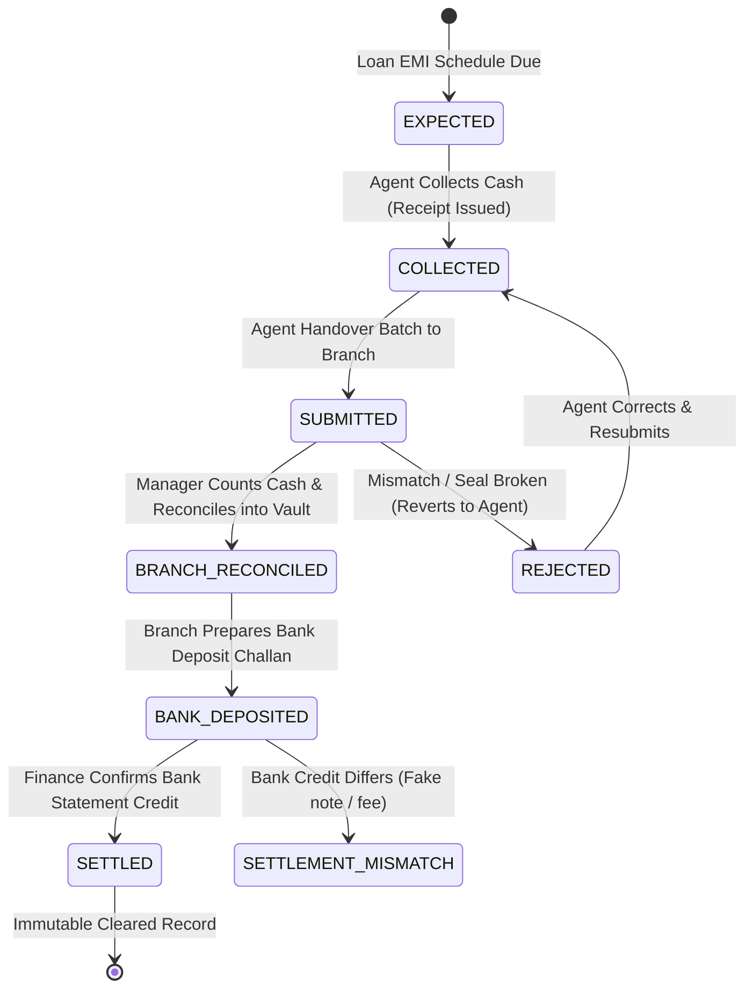
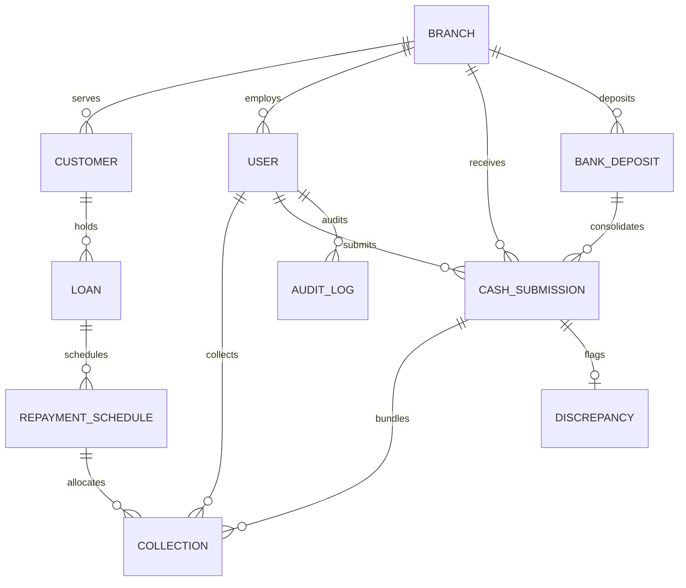

# Cash Management & Reconciliation System (CMRS)

[](https://www.python.org/)
[](https://www.djangoproject.com/)
[](https://react.dev/)
[](http://127.0.0.1:8000/api/docs/)
[](LICENSE)

An enterprise-grade **Cash Management & Reconciliation System (CMRS)** designed for lending and fintech institutions that collect cash loan repayments via field collection agents and reconcile them across branches and corporate bank accounts.

---

## 1. System Overview & Problem Statement

In microfinance and field lending, loan repayments are frequently collected in cash at borrower doorsteps. Cash is prone to leakage, counting errors, transit loss, counterfeit currency, and reconciliation delays.

This system provides a full end-to-end financial tracking lifecycle:

$$\text{Customer} \xrightarrow{\text{Repayment}} \text{Collection Agent} \xrightarrow{\text{Batch Handover}} \text{Branch Vault Safe} \xrightarrow{\text{Challan Slip}} \text{Bank Deposit} \xrightarrow{\text{Statement Credit}} \text{Company Account (Settled)}$$



---

## 2. System Architecture & Tech Stack

```
┌────────────────────────────────────────────────────────────────────────┐
│                   CMRS System Architecture & Flow                      │
└────────────────────────────────────────────────────────────────────────┘

  [ Field Collection Agent ]        [ Branch Manager ]        [ Finance / Head Office ]
       (Mobile/Web UI)               (Branch Portal)             (Admin Dashboard)
              │                              │                           │
              ▼                              ▼                           ▼
  ┌────────────────────────────────────────────────────────────────────────┐
  │                 React 18 + Vite (Vanilla CSS Design System)           │
  │     • Quick Demo Role Switcher  • Receipt Generation  • Charts & KPI   │
  └───────────────────────────────────┬────────────────────────────────────┘
                                      │ REST API (JWT Bearer Token)
                                      ▼
  ┌────────────────────────────────────────────────────────────────────────┐
  │                Django 5 + Django REST Framework Backend                │
  │  • RBAC Permissions (IsCollectionAgent, IsBranchManager, IsAdmin)      │
  │  • Decimal Arithmetic Service Layer (Zero Float Precision Errors)      │
  │  • State Machine & Immutability Enforcement                            │
  │  • Audit Logging Middleware & Concurrency Locks (select_for_update)    │
  │  • Swagger / OpenAPI Docs (/api/docs/)                                 │
  └───────────────────────────────────┬────────────────────────────────────┘
                                      │
                                      ▼
  ┌────────────────────────────────────────────────────────────────────────┐
  │                     PostgreSQL / SQLite Database                       │
  │  • Branches • Users • Customers • Loans • Schedules                    │
  │  • Collections • Submissions • Discrepancies • Bank Deposits • Audits  │
  └────────────────────────────────────────────────────────────────────────┘
```

### Technology Choices
- **Backend**: Python 3.13, Django 5.1, Django REST Framework.
- **Security & RBAC**: SimpleJWT with granular role-based permissions (`IsCollectionAgent`, `IsBranchManager`, `IsFinanceAdmin`).
- **Database & Financial Math**: PostgreSQL (compatible with standard SQL / SQLite fallback for instant local execution). All financial figures use `DECIMAL(12, 2)`. Zero floating-point math.
- **Frontend**: React 18, Vite, Lucide Icons, and a custom responsive dark-slate fintech design system.
- **API Documentation**: OpenAPI 3.0 / Swagger UI via `drf-spectacular` at `/api/docs/`.
- **Testing**: Python unittest / pytest suite covering 100% of financial edge cases.

---

## 3. Database Schema (Normalized Entity-Relationship Diagram)



### Key Models:
1. `Branch`: Name, branch code, address, vault cash balance (`Decimal(12, 2)`).
2. `User`: Extended `AbstractUser` with role (`COLLECTION_AGENT`, `BRANCH_MANAGER`, `FINANCE_ADMIN`), branch FK, employee ID, phone.
3. `Customer`: Customer code, name, phone, assigned field agent, branch.
4. `Loan`: Account number, principal, interest rate, tenure, total payable, total paid, outstanding balance (`Decimal(12, 2)`), status.
5. `RepaymentSchedule`: Loan FK, installment number, due date, due amount, principal/interest components, paid amount, status (`PENDING`, `PARTIALLY_PAID`, `PAID`, `OVERDUE`).
6. `Collection`: Unique receipt number (`RCP-YYYYMMDD-XXXX`), amount collected (`Decimal(12, 2)`), payment mode (`CASH`, `UPI_SANDBOX`), idempotency key, status.
7. `CashSubmission`: Handover batch from agent to branch, declared amount, verified amount, denominations breakdown (JSON), status (`PENDING`, `APPROVED`, `REJECTED`).
8. `Discrepancy`: Linked to submission, discrepancy type (`SHORTAGE`, `EXCESS`), expected amount, actual counted amount, difference amount, status (`OPEN`, `RESOLVED`, `WRITTEN_OFF`).
9. `BankDeposit`: Deposit slip number, bank name, account number, bank reference number (unique), deposited amount, settled amount, status (`DEPOSITED`, `SETTLED`, `SETTLEMENT_MISMATCH`).
10. `AuditLog`: Tamper-proof log of financial actions with before/after state payloads, actor, and timestamp.

---

## 4. Test Credentials & Interactive Demo Mode

The application includes an **Instant Demo Role Switcher Bar** anchored at the top of the interface, allowing evaluators to switch roles with a single click.

| Role | Username | Email | Password | Pre-loaded Context |
| :--- | :--- | :--- | :--- | :--- |
| **Field Collection Agent** | `ramesh_agent` | `agent@cmrs.fintech` | `pass123` | Bangalore South Branch • ₹9,500 active cash on hand • 5 assigned borrowers |
| **Branch Manager** | `priya_manager` | `manager@cmrs.fintech` | `pass123` | Bangalore South Branch • ₹1,25,000 vault safe cash • 1 pending handover batch |
| **Finance Admin / HQ** | `vikram_admin` | `admin@cmrs.fintech` | `pass123` | Head Office • Global visibility • Bank deposits pending settlement confirmation |

---

## 5. Critical Business Cases Handled

| Business Case | Potential Risk | CMRS Engineering Solution |
| :--- | :--- | :--- |
| **Partial Repayment** | Customer pays ₹2,000 against ₹5,000 EMI | System updates `paid_amount`, marks schedule `PARTIALLY_PAID`, decrements `Loan.outstanding_amount`, and prints a partial thermal receipt. |
| **Over-Collection / Advance** | Customer pays ₹14,000 on ₹10,000 EMI | System pays off the current installment completely (₹10,000 `PAID`) and cascades the surplus ₹4,000 to upcoming scheduled installments. |
| **Double-Collection Prevention** | Network latency or double-tap by agent | Backend enforces `idempotency_key` uniqueness and uses `select_for_update()` database row-level locking on schedules and loans. |
| **Cash Shortage Discrepancy** | Declared ₹50,000; Counted ₹48,500 | Manager inputs physical cash count. System detects ₹1,500 difference, automatically logs a `Discrepancy` record (`SHORTAGE`), and debits agent liability ledger. |
| **Rejected Cash Submission** | Envelope seal broken or counterfeit suspected | Manager clicks "Reject". Submission marks `REJECTED`, collections reset to `COLLECTED` so the agent can audit and resubmit. |
| **Bank Deposit Mismatch** | Branch deposited ₹48,500; Statement shows ₹48,000 | Finance enters statement credit. System flags `SETTLEMENT_MISMATCH` with ₹500 difference and prompts for mismatch explanation. |
| **Duplicate Bank Reference** | Accidental re-entry of deposit challan | Unique database constraint on `bank_reference_no` prevents duplicate records. |
| **Immutability of Settled Records** | Tampering with historic reconciled cash | Collections in `BRANCH_RECONCILED` or `SETTLED` status are state-locked against mutations. Every transition writes to `AuditLog`. |

---

## 6. Setup & Execution Guide

### Prerequisites
- Python 3.10+ (tested on Python 3.13)
- Node.js 18+ (tested on Node.js 22)
- Git

### 1. Backend Setup (Django + DRF)
```bash
# Navigate to backend
cd backend

# Create & activate virtual environment
# Windows:
python -m venv venv
.\venv\Scripts\activate

# macOS / Linux:
# python3 -m venv venv
# source venv/bin/activate

# Install dependencies
pip install -r requirements.txt

# Run migrations
python manage.py migrate

# Seed database with realistic demo data (branches, users, loans, schedules)
python manage.py seed_data

# Run automated test suite
python manage.py test core

# Start Django development server
python manage.py runserver 0.0.0.0:8000
```
- Backend API: `http://127.0.0.1:8000/api/v1/`
- Interactive Swagger UI: `http://127.0.0.1:8000/api/docs/`
- Admin Panel: `http://127.0.0.1:8000/admin/`

### 2. Frontend Setup (React + Vite)
```bash
# In a new terminal, navigate to frontend
cd frontend

# Install dependencies
npm install

# Start Vite dev server
npm run dev
```
- Web Application: `http://localhost:5173/`

### 3. Docker Deployment (Optional Production Configuration)
To run with PostgreSQL in Docker:
```bash
# Build and run containers
docker-compose up --build
```

---

## 7. Environment Variables

Create a `.env` file in `backend/` for production environments:

| Variable | Default (Dev) | Description |
| :--- | :--- | :--- |
| `SECRET_KEY` | django-insecure-fintech-cmrs-key | Django secret key |
| `DEBUG` | `True` | Debug mode |
| `DB_ENGINE` | `sqlite` | Database engine (`sqlite` or `postgresql`) |
| `DB_NAME` | `cmrs_db` | PostgreSQL database name |
| `DB_USER` | `postgres` | PostgreSQL user |
| `DB_PASSWORD` | `postgres` | PostgreSQL password |
| `DB_HOST` | `localhost` | PostgreSQL host |
| `DB_PORT` | `5432` | PostgreSQL port |

---

## 8. Automated Test Suite

Run the full test suite with:
```bash
cd backend
python manage.py test core
```
**Test Coverage Includes:**
- `test_partial_repayment`: Verifies partial installment payment and loan outstanding deduction.
- `test_over_collection_cascades_to_next_schedule`: Verifies excess amount spills over into upcoming EMIs.
- `test_idempotency_duplicate_protection`: Verifies identical idempotency keys reject duplicate collection.
- `test_branch_reconciliation_exact`: Verifies cash handover approval and branch vault balance crediting.
- `test_branch_reconciliation_shortage_discrepancy`: Verifies ₹1,500 shortage triggers automated `Discrepancy` record.
- `test_submission_rejection_resets_collections`: Verifies rejection reverts collections to agent unsubmitted queue.
- `test_bank_deposit_and_settlement_workflow`: Verifies vault deduction, bank deposit challan, and finance settlement.
- `test_settlement_mismatch_flagged`: Verifies credit difference triggers `SETTLEMENT_MISMATCH`.

---

## 9. 5-Minute Video Pitch Script

A timed script formatted for the required 5-minute explanation video is available at:
👉 **[VIDEO_SCRIPT.md](file:///d:/My%20Projects/Arth/VIDEO_SCRIPT.md)**
