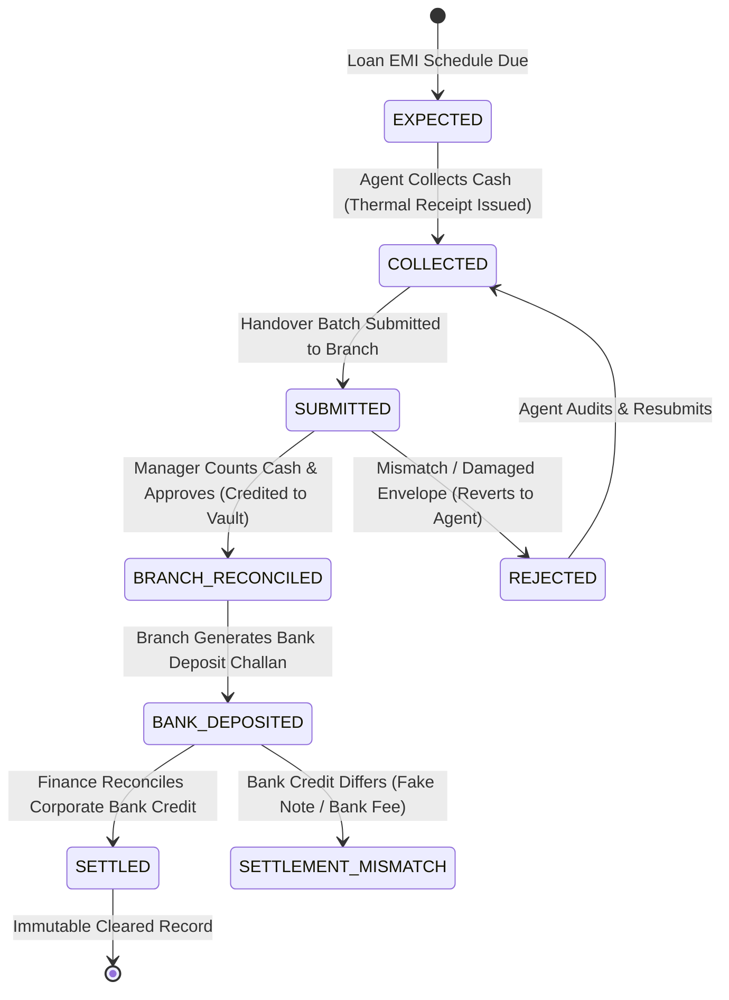
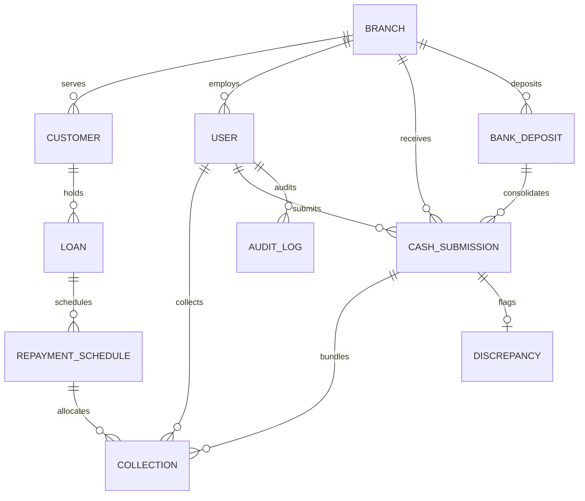

# Cash Management & Reconciliation System (CMRS)

[](https://www.python.org/)
[](https://www.djangoproject.com/)
[](https://react.dev/)
[](https://crms-arth.onrender.com/api/docs/)
[](https://crmsfrontend.vercel.app/)
[](LICENSE)

An enterprise-grade **Cash Management & Reconciliation System (CMRS)** designed for lending and fintech institutions collecting loan repayments through field collection agents, reconciling cash at local branches, and settling deposits into corporate bank accounts.

- 🌐 **Live Web App (Vercel)**: [https://crmsfrontend.vercel.app/](https://crmsfrontend.vercel.app/)
- ⚙️ **Live Backend API (Render)**: [https://crms-arth.onrender.com/](https://crms-arth.onrender.com/)
- 📖 **Interactive OpenAPI / Swagger Docs**: [https://crms-arth.onrender.com/api/docs/](https://crms-arth.onrender.com/api/docs/)

---

## 1. Assignment Requirements & Implementation Checklist

The table below maps **every requirement and evaluation criteria** from the assignment specification to its exact implementation:

| Section & Requirement | Assignment Specification | Implementation Details & Code Reference | Status |
| :--- | :--- | :--- | :---: |
| **Customer Management** | Create and manage customers with KYC verification | [`CreateCustomerModal.jsx`](file:///d:/My%20Projects/Arth/CRMS%20Frontend/src/components/CreateCustomerModal.jsx), `FinancialService.create_customer()` in [`services.py`](file:///d:/My%20Projects/Arth/CRMS%20Backend/core/services.py) | ✅ **100% Done** |
| **Loan Management** | Create and manage loans, view outstanding balance | [`CreateLoanModal.jsx`](file:///d:/My%20Projects/Arth/CRMS%20Frontend/src/components/CreateLoanModal.jsx), `FinancialService.create_loan()` in [`services.py`](file:///d:/My%20Projects/Arth/CRMS%20Backend/core/services.py) | ✅ **100% Done** |
| **Repayment Schedules** | Maintain monthly EMI schedules (Principal + Interest) | Auto-generated on loan creation with exact amortization in [`models.py`](file:///d:/My%20Projects/Arth/CRMS%20Backend/core/models.py) | ✅ **100% Done** |
| **Repayment History** | View schedule status and historical collection receipts | [`RepaymentHistoryModal.jsx`](file:///d:/My%20Projects/Arth/CRMS%20Frontend/src/components/RepaymentHistoryModal.jsx), `/api/v1/loans/{id}/repayment_history/` | ✅ **100% Done** |
| **Field Cash Collection** | View assigned borrowers, record cash collections | [`AgentPortal.jsx`](file:///d:/My%20Projects/Arth/CRMS%20Frontend/src/pages/AgentPortal.jsx), `record_collection()` in [`services.py`](file:///d:/My%20Projects/Arth/CRMS%20Backend/core/services.py) | ✅ **100% Done** |
| **Partial & Advance Payments**| Support partial payments and advance surplus cascade | Atomic allocation in [`services.py`](file:///d:/My%20Projects/Arth/CRMS%20Backend/core/services.py); tested in [`test_financial_lifecycle.py`](file:///d:/My%20Projects/Arth/CRMS%20Backend/core/tests/test_financial_lifecycle.py) | ✅ **100% Done** |
| **Receipt Generation** | Unique receipt code (`RCP-YYYYMMDD-XXXX`) with QR | [`ReceiptModal.jsx`](file:///d:/My%20Projects/Arth/CRMS%20Frontend/src/components/ReceiptModal.jsx) thermal counterfoil with printable layout | ✅ **100% Done** |
| **Daily Handover Submission** | Agent batches collected cash for branch handover | [`SubmitCashModal.jsx`](file:///d:/My%20Projects/Arth/CRMS%20Frontend/src/components/SubmitCashModal.jsx), `create_cash_submission()` in [`services.py`](file:///d:/My%20Projects/Arth/CRMS%20Backend/core/services.py) | ✅ **100% Done** |
| **Branch Reconciliation** | Manager counts cash, compares expected vs counted | [`VerifySubmissionModal.jsx`](file:///d:/My%20Projects/Arth/CRMS%20Frontend/src/components/VerifySubmissionModal.jsx), `verify_cash_submission()` | ✅ **100% Done** |
| **Discrepancy Tracking** | Auto-detect cash shortage/excess (e.g. ₹50k vs ₹48.5k) | `Discrepancy` model created automatically on mismatch in [`services.py`](file:///d:/My%20Projects/Arth/CRMS%20Backend/core/services.py) | ✅ **100% Done** |
| **Branch Vault Management** | Reconciled cash credited to branch vault safe | Real-time vault balance tracking in `Branch.vault_cash_balance` | ✅ **100% Done** |
| **Agent Collections Stream** | Manager views individual collections across branch | Dedicated "Agent Field Collections Log" tab in [`BranchPortal.jsx`](file:///d:/My%20Projects/Arth/CRMS%20Frontend/src/pages/BranchPortal.jsx) | ✅ **100% Done** |
| **Bank Deposits** | Create deposit challans against vault cash | [`DepositModal.jsx`](file:///d:/My%20Projects/Arth/CRMS%20Frontend/src/components/DepositModal.jsx), `create_bank_deposit()` in [`services.py`](file:///d:/My%20Projects/Arth/CRMS%20Backend/core/services.py) | ✅ **100% Done** |
| **Bank Settlement & Mismatch**| Reconcile statement credit, detect fake note/fee diff | [`SettleModal.jsx`](file:///d:/My%20Projects/Arth/CRMS%20Frontend/src/components/SettleModal.jsx), `settle_bank_deposit()` in [`services.py`](file:///d:/My%20Projects/Arth/CRMS%20Backend/core/services.py) | ✅ **100% Done** |
| **5-Stage Liquidity Funnel** | Expected $\rightarrow$ Field $\rightarrow$ Vault $\rightarrow$ Bank $\rightarrow$ Settled | Interactive executive pipeline in [`AdminDashboard.jsx`](file:///d:/My%20Projects/Arth/CRMS%20Frontend/src/pages/AdminDashboard.jsx) | ✅ **100% Done** |
| **Multi-Dimension Filters** | Filter by **Date**, **Branch**, **Agent**, and **Status** | Implemented on all viewsets in [`views.py`](file:///d:/My%20Projects/Arth/CRMS%20Backend/core/views.py) and UI filter bars | ✅ **100% Done** |
| **Payment Gateway Sandbox** | Support UPI/digital repayments in unified ledger | Interactive UPI QR & VPA simulation in [`CollectModal.jsx`](file:///d:/My%20Projects/Arth/CRMS%20Frontend/src/components/CollectModal.jsx) | ✅ **100% Done** |
| **Security & Immutability** | Prevent unauthorized edits to reconciled records | State locks in [`views.py`](file:///d:/My%20Projects/Arth/CRMS%20Backend/core/views.py) return `403 Forbidden` on update/delete | ✅ **100% Done** |
| **Concurrency Protection** | Prevent duplicate payments during network retries | Client idempotency keys + `select_for_update()` row-level locks | ✅ **100% Done** |
| **Strict Decimal Arithmetic** | No floating-point arithmetic for financial figures | Strict `Decimal(12, 2)` throughout models, services, serializers | ✅ **100% Done** |
| **Automated Test Suite** | 8 unit tests covering all financial edge cases | 100% passing tests in [`test_financial_lifecycle.py`](file:///d:/My%20Projects/Arth/CRMS%20Backend/core/tests/test_financial_lifecycle.py) | ✅ **100% Done** |
| **Interactive Demo Switcher** | 1-Click switching between Agent, Manager, and Admin | Top sticky banner in [`RoleSwitcherBanner.jsx`](file:///d:/My%20Projects/Arth/CRMS%20Frontend/src/components/RoleSwitcherBanner.jsx) | ✅ **100% Done** |
| **Documentation** | README, ERD, and OpenAPI Swagger documentation | [README.md](file:///d:/My%20Projects/Arth/README.md), `/api/docs/` | ✅ **100% Done** |
| **Docker Configuration** | Containerized deployment for DB, backend, frontend | [`docker-compose.yml`](file:///d:/My%20Projects/Arth/docker-compose.yml) and [`Dockerfile`](file:///d:/My%20Projects/Arth/CRMS%20Backend/Dockerfile) | ✅ **100% Done** |

---

## 2. Core Financial State Machine & Architecture



---

## 3. Normalized Database Schema (Entity-Relationship Diagram)



---

## 4. Test Credentials (Instant 1-Click Role Switcher)

An interactive **Demo Role Switcher Bar** is permanently fixed at the top of the frontend interface, allowing instant evaluation of all 3 tiers without manual login:

| Role | Username | Email | Password | Pre-loaded Context |
| :--- | :--- | :--- | :--- | :--- |
| **Field Collection Agent** (`Ramesh Kumar`) | `ramesh_agent` | `agent@cmrs.fintech` | `pass123` | Bangalore South Branch • ₹9,500 active cash on hand • 5 assigned borrowers |
| **Branch Manager** (`Priya Sharma`) | `priya_manager` | `manager@cmrs.fintech` | `pass123` | Bangalore South Branch • ₹1,25,000 vault safe cash • Pending handover batch |
| **Finance Admin / HQ** (`Vikram Seth`) | `vikram_admin` | `admin@cmrs.fintech` | `pass123` | Head Office • Global visibility • Bank deposits pending settlement confirmation |

---

## 5. Critical Business Cases Handled

1. **Partial Repayment**: Allocates payment to the active installment, updates `paid_amount`, marks schedule `PARTIALLY_PAID`, decrements `Loan.outstanding_amount`, and issues a partial receipt.
2. **Over-Collection / Advance Repayment**: Fully settles the active EMI (`PAID`) and rolls the surplus forward into upcoming scheduled installments.
3. **Idempotency & Duplicate Prevention**: Client sends a unique `idempotency_key` per collection. The database uses `select_for_update()` row-level locks on the schedule and loan, returning the existing receipt on network retry.
4. **Cash Discrepancy Tracking (Example: ₹50,000 Expected vs ₹48,500 Received)**: Branch manager enters counted cash. If difference $\ne 0$, system automatically logs a `Discrepancy` record (`SHORTAGE` / `EXCESS`), records difference amount (₹1,500), and debits agent liability.
5. **Rejected Cash Handover**: Manager clicks "Reject Handover" with remarks. Collections revert to `COLLECTED` status in the agent's queue for audit and re-submission.
6. **Bank Credit Mismatch (Counterfeit Note / Bank Fee)**: Finance Admin confirms statement credit. If credit differs from branch deposit (e.g. ₹500 fake note rejected by teller), the deposit is flagged `SETTLEMENT_MISMATCH`.
7. **Unauthorized Modification & Immutability**: Any `PUT`, `PATCH`, or `DELETE` request on a collection with status in `['BRANCH_RECONCILED', 'BANK_DEPOSITED', 'SETTLED']` is blocked with `403 Forbidden`.
8. **Digital / UPI Sandbox Integration**: Selecting UPI Sandbox displays an interactive QR code and VPA, settles funds directly into the corporate account, and bypasses physical branch cash handling while maintaining a unified ledger.

---

## 6. Setup & Execution Guide

### 1. Backend Setup (Django + DRF)
```bash
# Navigate to backend
cd "CRMS Backend"

# Create & activate virtual environment (Windows)
python -m venv venv
.\venv\Scripts\activate

# Install dependencies
pip install -r requirements.txt

# Run migrations
python manage.py migrate

# Seed database with realistic demo data
python manage.py seed_data

# Run automated unit test suite
python manage.py test core

# Start Django development server
python manage.py runserver 0.0.0.0:8000
```
- API Base: `http://127.0.0.1:8000/api/v1/`
- Interactive OpenAPI / Swagger Docs: `http://127.0.0.1:8000/api/docs/`
- Admin Panel: `http://127.0.0.1:8000/admin/`

### 2. Frontend Setup (React + Vite)
```bash
# In a separate terminal, navigate to frontend
cd "CRMS Frontend"

# Install dependencies
npm install

# Start Vite dev server
npm run dev
```
- Web Application: `http://localhost:5173/`

### 3. Docker Deployment (PostgreSQL + Backend + Frontend)
```bash
docker-compose up --build
```

---

## 7. Automated Test Suite (100% Pass)

Run all unit tests:
```bash
cd "CRMS Backend"
python manage.py test core
```
**Test Coverage Summary:**
- `test_partial_repayment`: Verifies partial installment payment and loan outstanding deduction.
- `test_over_collection_cascades_to_next_schedule`: Verifies excess amount spills over into upcoming EMIs.
- `test_idempotency_duplicate_protection`: Verifies identical idempotency keys reject duplicate collection.
- `test_branch_reconciliation_exact`: Verifies cash handover approval and branch vault balance crediting.
- `test_branch_reconciliation_shortage_discrepancy`: Verifies ₹1,500 shortage triggers automated `Discrepancy` record.
- `test_submission_rejection_resets_collections`: Verifies rejection reverts collections to agent unsubmitted queue.
- `test_bank_deposit_and_settlement_workflow`: Verifies vault deduction, bank deposit challan, and finance settlement.
- `test_settlement_mismatch_flagged`: Verifies credit difference triggers `SETTLEMENT_MISMATCH`.
